# Tóm tắt nghiên cứu

Bản nghiên cứu phục vụ học phần, ngày 08/11/2026. Thời gian được mô phỏng: 01/2024–12/2025. Tên sách, tác giả, nhà xuất bản, kênh bán và toàn bộ giao dịch đều giả lập. Không sử dụng dữ liệu giao dịch của doanh nghiệp hay khách hàng thật.

Tóm tắt. Đề tài xây dựng 6.500 đơn một đầu sách từ danh mục 300 sách giả lập, chủ động thêm lỗi để tạo 6.660 dòng thô. Quy trình chuẩn hóa, đối chiếu danh mục và xử lý mã dòng thu được 6.478 dòng phân tích. Các trường được đối chiếu trên tập giữ lại khớp dữ liệu chuẩn; tuy nhiên giá trị bán hàng toàn kỳ vẫn chênh 2,992% do cách ly bản ghi. Điều này cho thấy tính đúng của từng dòng giữ lại khác với độ đầy đủ của toàn bộ dữ liệu.

Kết quả mô tả của kịch bản cơ sở: 3.067.680.000 đồng giá trị bán hàng, 32.100 cuốn và 301 mã sách có phát sinh bán. Ba kịch bản được lặp 50 lần để xem kết quả thay đổi khi bỏ hệ số khuyến mãi hoặc mùa vụ. Các khác biệt thu được chỉ đánh giá hành vi mô hình dưới giả định, không xác nhận quy luật thị trường Việt Nam.

Đóng góp thực hành là một quy trình có thể chạy lại: dữ liệu thô và chuẩn tách biệt; quy tắc làm sạch có nhật ký; số liệu báo cáo lấy từ bảng kết quả; biểu đồ, dashboard và notebook dùng chung hàm phân tích.

Từ khóa: kinh doanh sách; dữ liệu mô phỏng; chất lượng dữ liệu; phân tích khám phá; tái lập; phân tích độ nhạy.

Bảng 1 tóm tắt các chỉ tiêu cơ sở của kịch bản chính; mọi giá trị trong bảng được lấy trực tiếp từ kết quả pipeline, không chép tay.

**Bảng 1. Tóm tắt các chỉ tiêu cơ sở của kịch bản chính**

| Chỉ tiêu cơ sở | Giá trị |
| --- | --- |
| Dòng thô / dòng giữ lại | 6.660 / 6.478 |
| Mã sách trong tập sạch | 301 |
| Giá trị bán hàng | 3.067.680.000 đồng |
| Sai lệch so với toàn bộ dữ liệu chuẩn | 2,992% |

# Chương 1 Tổng quan đề tài

Hoạt động bán sách tạo ra dữ liệu ở nhiều cấp độ, từ danh mục đầu sách đến từng dòng giao dịch. Để sử dụng dữ liệu phục vụ quản lý, cần thống nhất đơn vị quan sát, xác định các trường hợp sai và xây dựng chỉ tiêu có ý nghĩa nghiệp vụ. Một tổng bán hàng có thể tính đúng về số học nhưng vẫn thiếu giao dịch hoặc bị đếm lặp. Vì vậy, đề tài xem chất lượng dữ liệu và diễn giải kết quả là hai phần liên kết của cùng quá trình phân tích.

Mục tiêu tổng quát là xây dựng bộ dữ liệu kinh doanh sách, xử lý dữ liệu, trực quan hóa và rút ra ý nghĩa từ kết quả. Các mục tiêu cụ thể gồm thiết kế danh mục và giao dịch có khóa định danh, mô phỏng lỗi thường gặp, xây dựng quy trình xử lý có thể truy vết, mô tả cơ cấu bán hàng và đánh giá mức phụ thuộc của kết luận vào giả định đầu vào.

Phạm vi nghiên cứu gồm 300 đầu sách thuộc 10 thể loại, năm kênh giả lập và thời gian từ tháng 1 năm 2024 đến tháng 12 năm 2025. Bộ dữ liệu được xây dựng bằng mô phỏng để có thể biết giá trị chuẩn trước khi cài lỗi. Lựa chọn này cho phép đánh giá trực tiếp khả năng phục hồi dữ liệu, đồng thời giới hạn mọi kết luận kinh doanh trong phạm vi mô hình đã thiết kế.

Báo cáo triển khai theo sáu chương. Chương 1 xác định bài toán và câu hỏi. Chương 2 trình bày cơ sở phương pháp. Chương 3 mô tả quá trình xây dựng và xử lý dữ liệu. Chương 4 phân tích kết quả trực quan. Chương 5 đánh giá độ nhạy. Chương 6 thảo luận ý nghĩa, hạn chế và hướng phát triển. Các phụ lục cung cấp cấu trúc dữ liệu và cách tái lập kết quả.

# 1.1 Câu hỏi và thiết kế nghiên cứu

Bối cảnh thực hành là một nhà sách giả định cần hiểu cơ cấu sản phẩm, kênh bán và thời điểm phát sinh giá trị bán hàng, đồng thời kiểm soát lỗi trong dữ liệu nhập từ nhiều nguồn. Bài không có mẫu xác suất từ thị trường nên không đặt mục tiêu ước lượng thị phần, lợi nhuận hay hành vi độc giả thực.

Bảy câu hỏi mô tả: (1) thể loại nào đóng góp nhiều giá trị và số cuốn; (2) mã sách nào có giá trị bán hàng cao; (3) giá trị thay đổi theo tháng ra sao; (4) mức giá, giảm giá và lượng có quan hệ gì; (5) điểm giả lập có liên hệ với lượng ở cấp sách không; (6) cấu trúc tương quan giữa các biến ra sao; (7) cơ cấu theo kênh và phân khúc giá như thế nào. Câu hỏi kiểm chứng bổ sung: làm sạch sửa đúng đến đâu, mất bao nhiêu dữ liệu, và kết quả phụ thuộc giả định ra sao?

Thiết kế tham khảo cấu trúc ADEMP [1], áp dụng ở mức phù hợp học phần: mục tiêu, cơ chế sinh, đại lượng cần tính, phương pháp và tiêu chí đánh giá. Đây là vận dụng khung báo cáo thí nghiệm mô phỏng, không phải nghiên cứu đề xuất phương pháp thống kê mới.

Đơn vị dữ liệu là dòng đơn hàng một đầu sách. Mỗi mã đơn chỉ có một mã dòng trong mô hình này; số cuốn có thể lớn hơn 1. Không mô phỏng khách hàng, đơn nhiều đầu sách, chi phí, tồn kho, hoàn/hủy hoặc phễu chuyển đổi. Vì vậy không tính CAC, tỷ lệ mua lại, tỷ lệ bỏ giỏ hoặc lợi nhuận.

Đại lượng chính là tổng giá trị bán hàng T = tổng(giá bán × số cuốn). Giá bình quân theo cuốn = T / tổng số cuốn. Tỷ trọng nhóm = giá trị nhóm / T. Tăng trưởng mô phỏng năm 2025 = (T2025 / T2024 − 1) × 100%. Những đại lượng này đều mô tả tập dữ liệu, không ước lượng tổng thể thị trường.

# Chương 2 Cơ sở phương pháp

Phân tích khám phá dữ liệu được sử dụng để mô tả phân phối, phát hiện quan sát bất thường và xác định quan hệ cần xem xét sâu hơn. Trong đề tài này, thống kê mô tả đi trước diễn giải kinh doanh. Mỗi kết quả phải xác định tập dữ liệu, đơn vị quan sát, công thức tổng hợp và mẫu số. Cách tổ chức này giúp phân biệt sự thay đổi của dữ liệu với sự thay đổi do bộ lọc hoặc cách tính.

Chất lượng dữ liệu được đánh giá qua tính hợp lệ, đầy đủ, duy nhất và nhất quán. Tính hợp lệ kiểm tra miền giá trị như số lượng nguyên dương và điểm trong khoảng 1 đến 5. Tính đầy đủ gồm độ bao phủ của trường và giao dịch. Tính duy nhất được kiểm tra bằng mã dòng nghiệp vụ. Tính nhất quán được đánh giá qua quan hệ giữa giá gốc, giảm giá và giá bán. Việc đạt một tiêu chí không suy ra các tiêu chí còn lại cũng đạt.

Khung ADEMP được dùng để trình bày rõ mục tiêu, cơ chế sinh dữ liệu, đại lượng cần đánh giá, phương pháp và thước đo kết quả [1]. Trong nghiên cứu này, dữ liệu chuẩn tạo điều kiện đối chiếu nhưng được tách khỏi đầu vào làm sạch. Việc tách này giúp kiểm tra quy trình phục hồi bằng thông tin nghiệp vụ sẵn có thay vì vô tình sử dụng đáp án của thí nghiệm.

Với dòng i, đặt pᵢ là giá bán và qᵢ là số cuốn. Giá trị dòng bằng pᵢ × qᵢ. Tổng giá trị T là tổng giá trị của mọi dòng giữ lại, còn tổng lượng Q là tổng qᵢ. Giá bình quân có trọng số bằng T/Q. Trung bình đơn giản của giá theo dòng cho mỗi giao dịch trọng số bằng nhau, nên trả lời một câu hỏi khác khi số cuốn mỗi dòng khác nhau.

Hệ số Pearson đo liên hệ tuyến tính giữa hai biến, nằm trong khoảng từ −1 đến 1 khi phương sai khác không. Hệ số gần 0 có thể đi cùng một quan hệ phi tuyến hoặc nhiều nhóm có cấu trúc khác nhau. Trong dữ liệu này, một sách xuất hiện nhiều lần nên phân tích điểm sách được tổng hợp ở cấp mã sách. Việc lựa chọn cấp tổng hợp là một phần của thiết kế phân tích.

Boxplot mô tả trung vị, tứ phân vị và các điểm nằm ngoài râu hộp [3]. Quy tắc 1,5 lần khoảng tứ phân vị cung cấp dấu hiệu cần xem xét. Quyết định giữ hay cách ly còn phụ thuộc miền giá trị và bối cảnh nghiệp vụ. Các dòng mua nhiều được xem xét riêng vì có thể chi phối trung bình và hệ số tương quan.

Biểu đồ cột phù hợp so sánh các nhóm danh mục, biểu đồ đường thể hiện thứ tự thời gian, biểu đồ phân tán thể hiện quan hệ hai biến và ma trận tương quan tóm tắt liên hệ tuyến tính. Khi dùng thang log cho lượng bán, khoảng cách bằng nhau biểu thị tỷ lệ thay đổi bằng nhau. Chú thích biểu đồ cần giúp người đọc nhận diện phép biến đổi này trước khi so sánh.

# Chương 3 Xây dựng và xử lý dữ liệu

Quy trình gồm thiết kế danh mục, sinh giao dịch chuẩn, tạo bản dữ liệu có lỗi, chuẩn hóa và đối chiếu kết quả. Ba lớp dữ liệu nguồn, dữ liệu xử lý và dữ liệu kiểm chứng có vai trò riêng. Các bước xử lý đều ghi nhật ký để giải thích số dòng thay đổi và giá trị được sửa.

# 3.1 Nguồn gốc và cơ chế sinh dữ liệu

Nguồn trực tiếp là src/data_generator.py. Không có dữ liệu được crawl hoặc mua từ các sàn. Các danh tính đều dùng nhãn giả lập để tránh ghép sai tác giả và nhà xuất bản vào tên sách có thật. Tài liệu tham khảo cung cấp cơ sở phương pháp; không được dùng để gán tính đại diện thị trường cho các tham số.

Danh mục gồm 300 mã sách, 30 mã cho mỗi thể loại. Năm xuất bản giả lập nằm trong 2.015–2.023 để luôn trước kỳ bán. Giá gốc được sinh từ phân phối log-normal với trung vị 120.000, độ lệch chuẩn log 0,48, làm tròn nghìn và chặn trong 45.000–350.000 đồng. Điểm sách = 1 + 4 × Beta(8,2), làm tròn 0,1; đây là thuộc tính giả lập cố định trước kỳ bán, không phải đánh giá tổng hợp cuối kỳ.

Thể loại được chọn theo trọng số [0,20; 0,18; 0,15; 0,13; 0,09; 0,06; 0,07; 0,04; 0,05; 0,03] theo thứ tự trong config.py. Kênh Sàn A/B/C, Cửa hàng, Website có trọng số [0,35; 0,22; 0,18; 0,15; 0,10]. Các giá trị là giả định thiết kế, chưa hiệu chỉnh theo dữ liệu thực.

Ngày bán được chọn đều trên 731 ngày của 2024–2025. Giảm giá niêm yết chọn đều từ {0,5,…,40}% cho ba sàn và {0,5,…,20}% cho hai kênh còn lại. Giá bán làm tròn đến nghìn từ giá gốc và giảm giá; tỷ lệ giảm thực tế được tính riêng để không nhầm với mức niêm yết.

Số cuốn = 1 + Poisson(λ), trong đó λ = 1,5 × S × max(0,5; 1,8 − giá_bán/200.000) × (1 + β × giảm_giá_niêm_yết/30). Cơ sở: β=1; S=1,7 tháng 11–12, S=1,3 tháng 8–9, còn lại S=1. 8 dòng mua số lượng lớn 155–200 cuốn được thêm độc lập để kiểm tra xử lý ngoại lệ. Đây không phải mô hình đã được xác thực dự báo kinh doanh.

Tính truy xuất: catalog.csv là danh mục nghiệp vụ đầu vào; ground_truth.csv chỉ dành cho đánh giá. injected_errors.csv mô tả lỗi đã cài; hàm làm sạch không đọc hai tệp kiểm chứng này. SHA-256 của tệp đầu ra được lưu trong manifest.json. Việc ghi metadata và nguồn gốc tham khảo nguyên tắc tái sử dụng dữ liệu [2].

Thiết kế mô phỏng còn phân biệt hai nguồn biến động. Biến động giữa các dòng đến từ ngày bán, sách, kênh và số cuốn được lấy ngẫu nhiên. Khác biệt có hệ thống đến từ trọng số thể loại, mức giảm theo kênh và hệ số mùa vụ. Khi một nhóm đứng đầu, cần xem lại cả hai nguồn trước khi diễn giải. Seed cố định cho phép tái tạo cùng bộ dữ liệu, còn nhiều seed cho phép quan sát mức dao động do tính ngẫu nhiên.

# 3.2 Quy trình làm sạch

Bước 1: ghi nhận số dòng, thiếu và khóa lặp. Bước 2: chuẩn hóa khoảng trắng, thể loại, kiểu số và tiền tệ. Giá âm/thiếu được phục hồi từ giá gốc và giảm giá niêm yết, sử dụng cùng quy tắc làm tròn nghìn của hệ thống giả lập. Cách sửa này chỉ hợp lệ nếu hai trường cơ sở đáng tin.

Các thuộc tính sách thiếu được tra bằng ma_sach trong catalog.csv, một đầu vào độc lập với nhãn lỗi. Bài giả định danh mục đã kiểm tra và bao phủ đủ mã trong kịch bản chính; giả định mạnh này làm bài toán phục hồi dễ hơn thực tế. Nếu không có dữ liệu tra, giữ điểm/năm ở trạng thái thiếu và gắn nhãn không rõ cho tên tác giả/NXB, không tự suy đoán thông tin thư mục.

Bước 3: gộp các bản sao có cùng mã dòng và cùng nội dung sau chuẩn hóa. Nếu cùng mã nhưng khác dữ liệu, cách ly tất cả biến thể để xác minh. Không dùng tên sách/ngày/kênh làm khóa thay thế vì các giao dịch độc lập có thể trùng thuộc tính.

Bước 4: cách ly số lượng không dương, không nguyên hoặc trên 1.000, ngày sai, miền giá trị sai. Ngưỡng 1.000 là quy tắc cần rà soát trong kịch bản, không phải quy luật bán lẻ. Điểm vượt Q3+1,5×IQR chỉ được đánh dấu, không tự xóa [3]; nhờ vậy các dòng mua nhiều vẫn được giữ nếu hợp lệ.

Tạo đặc trưng dùng một hàm chung: giá <80.000; 80.000≤giá≤200.000; giá>200.000. Điểm: <3,0; [3,0;4,0); [4,0;4,5); ≥4,5; thiếu thành Chưa biết. Quy ước biên được kiểm tra riêng vì pandas.cut mặc định đóng khoảng bên phải [4]. Nhật ký cell_changes ghi thay đổi ô; row_lineage cho biết trạng thái của từng dòng thô.

Bảng 2 trình bày số dòng, số ô thiếu và số mã dòng lặp sau từng bước; cột ô thiếu cho thấy dữ liệu thiếu được khôi phục hoặc cách ly ở bước nào.

Thứ tự làm sạch ảnh hưởng đến khả năng nhận diện bản sao. Hai dòng có cùng ý nghĩa nhưng khác cách viết tiền tệ hoặc khoảng trắng chỉ được nhận diện nhất quán sau chuẩn hóa. Ngược lại, gộp mọi dòng có cùng mã trước khi so nội dung có thể làm mất dấu xung đột. Quy trình vì vậy chuẩn hóa biểu diễn trước, so sánh nội dung theo khóa sau và ghi lại trạng thái cuối cho toàn bộ bản ghi nguồn.

**Bảng 2. Số dòng, ô thiếu và mã dòng lặp qua từng bước làm sạch**

| Bước | Dòng | Ô thiếu | Mã dòng lặp |
| --- | --- | --- | --- |
| Nạp dữ liệu | 6.660 | 539 | 160 |
| Chuẩn hóa và khôi phục có căn cứ | 6.660 | 1 | 160 |
| Gộp bản sao cùng mã và cùng nội dung | 6.505 | 1 | 5 |
| Cách ly bất thường và xung đột | 6.478 | 1 | 0 |

# 3.3 Đánh giá chất lượng sau xử lý

Trên 6.478 mã dòng giữ lại, tám trường được đối chiếu với dữ liệu chuẩn đều đạt tỷ lệ khớp 100%: giá bán, số lượng, giá trị bán hàng, điểm, năm xuất bản, tác giả, NXB và thể loại. Kết quả chỉ áp dụng cho các trường và lỗi đã thử; không có nghĩa mọi lỗi ngoài thực tế đều được xử lý đúng.

Có 27 dòng nguồn bị cách ly, tương ứng 22 mã dòng nghiệp vụ. 5 mã xung đột có hai biến thể mỗi mã. Tỷ lệ giữ lại trên 6.500 mã gốc là 99,662%.

Độ chính xác của cách ly đạt 100,0%: mọi dòng bị cách ly đều thực sự mang lỗi. Độ phủ chỉ đạt 2,1% và đây mới là con số cần đọc. Bản trước công bố 100%/100% vì mẫu số chỉ gồm hai họ lỗi mà quy tắc vốn nhắm tới, tức là quy tắc được đo bằng chính điều kiện nó đã dùng để cách ly. Khi tính trên toàn bộ 49 dòng mang lỗi thuộc tám họ, khoảng 97,9% lỗi vẫn nằm lại trong tập phân tích.

Bảng 4 tách kết quả theo từng họ. Quy tắc miền giá trị bắt được lỗi số lượng âm, số lượng không nguyên và mã sách không tồn tại. Nó không thể bắt lỗi vẫn nằm trong miền hợp lệ: giá bị đặt lại bằng giá gốc, giá bị hoán vị giữa hai dòng, ngày bị đảo, và thể loại sai nhưng hợp lệ. Với các họ đó, cột còn sai đo mức độ ảnh hưởng thực tế thay vì che nó bằng một tỷ lệ phát hiện cao.

Tổng chuẩn là 2.978.555.000 đồng; tập sạch có 3.067.680.000 đồng, sai lệch 2,992%. Trên đúng tập mã được giữ lại, sai lệch tổng bằng 99.657.000 đồng. Khi không thể phục hồi số lượng gốc, việc cách ly là thận trọng nhưng làm thiếu tổng bán hàng; cần công bố mức ảnh hưởng này.

Có 184 dòng bị gắn cờ IQR, gồm cả trường hợp lượng cao hợp lệ. Cần phân biệt kiểm tra hợp lệ theo miền dữ liệu với đánh giá hiếm gặp theo phân phối. Không dùng tỷ lệ ô thiếu bằng 0 làm thước đo duy nhất của chất lượng.

Mỗi dòng thô phải có đúng một trạng thái cuối: giữ, gộp bản sao hoặc cách ly. Các kiểm tra tự động còn bao phủ giá trị biên, mâu thuẫn khóa, dữ liệu thiếu danh mục, dòng mua nhiều, các tổng theo nhóm và tái lập cùng seed. Các kết quả thí nghiệm không thay cho xác nhận độc lập của giảng viên.

Bảng 3 đối chiếu từng trường với dữ liệu chuẩn trên tập giữ lại; cột thứ hai là số ô khớp trên số ô so sánh.

Số dòng giảm từ 6.660 xuống 6.478 cần được đọc theo hai mẫu số. Có 155 bản sao được gộp và 27 dòng nguồn được cách ly, tổng cộng 182 dòng rời tập nguồn. Tuy nhiên, 6.500 mã nghiệp vụ chuẩn chỉ giảm 22 mã, vì các bản sao không đại diện giao dịch bổ sung. Do đó tỷ lệ giữ dữ liệu nghiệp vụ được tính bằng 6.478/6.500, thay vì 6.478/6.660. Việc công bố cả hai số giúp tránh đánh đồng khử trùng với mất giao dịch.

Con số cần đọc không phải độ chính xác mà là độ phủ. Trên 49 dòng mang lỗi thuộc tám họ, chỉ 17 dòng bị cách ly, tức 34,7%. 32 dòng mang lỗi vẫn nằm trong tập phân tích và vẫn khác dữ liệu chuẩn. Bản trước công bố 100% cho cả độ chính xác và độ phủ vì mẫu số chỉ gồm hai họ lỗi mà quy tắc vốn nhắm tới; cách đo đó không thể phát hiện điều gì ngoài chính quy tắc đã dùng.

Việc tách theo họ lỗi không nhằm làm con số đẹp hơn mà để chỉ ra giới hạn của phương pháp. Bốn họ lỗi tạo ra giá trị vẫn hợp lệ: giá bị đặt lại bằng giá gốc, giá bị hoán vị giữa hai dòng, ngày bị đảo tháng và thể loại sai nhưng hợp lệ. Không quy tắc nào chỉ dựa trên miền giá trị phát hiện được chúng, và bài không dựng quy tắc đọc dữ liệu chuẩn để xóa chúng, vì làm vậy sẽ biến đáp án của thí nghiệm thành đầu vào của quy trình.

**Bảng 3. Đối chiếu tám trường với dữ liệu chuẩn trên tập giữ lại**

| Trường kiểm chứng | Khớp / đối chiếu |
| --- | --- |
| gia_ban | 6.468 / 6.478 |
| so_luong | 6.472 / 6.478 |
| doanh_thu | 6.462 / 6.478 |
| diem_danh_gia | 6.478 / 6.478 |
| nam_xuat_ban | 6.478 / 6.478 |
| tac_gia | 6.477 / 6.478 |
| nha_xuat_ban | 6.478 / 6.478 |
| the_loai | 6.473 / 6.478 |

# 3.4 Hiệu năng phát hiện theo họ lỗi

Một tỷ lệ phát hiện gộp không cho biết quy tắc làm sạch mạnh ở đâu và yếu ở đâu. Tám họ lỗi dưới đây được cài với số lượng ngẫu nhiên theo phân phối Poisson, nên số lỗi mỗi lần chạy cũng là biến ngẫu nhiên. Nhờ vậy tỷ lệ giữ lại có sai số thực thay vì là một hằng số thiết kế.

Cột tỷ lệ phát hiện là số dòng bị cách ly chia số dòng mang lỗi. Cột còn sai là số dòng mang lỗi vẫn nằm trong tập sạch và vẫn khác dữ liệu chuẩn; đây là thước đo thiệt hại thật, vì một dòng có thể bị cách ly vì lý do khác mà vẫn được tính là bắt được.

Ba họ không thể phát hiện bằng miền giá trị là lỗi bản chất của dữ liệu, không phải thiếu sót của mã. Giá bị đặt lại bằng giá gốc, giá bị hoán vị, ngày bị đảo và thể loại sai đều tạo ra giá trị hợp lệ. Chỉ dữ liệu đối chiếu bên ngoài hoặc kiểm tra chéo nguồn mới phát hiện được. Vì vậy bài giữ các dòng này lại, công bố ảnh hưởng và không dựng một quy tắc đọc dữ liệu chuẩn để xóa chúng.

Hình 1 xếp các họ theo tỷ lệ phát hiện, tô màu theo khả năng phát hiện. Bảng 4 ghi số lượng, tỷ lệ phát hiện và số dòng còn sai cho từng họ.

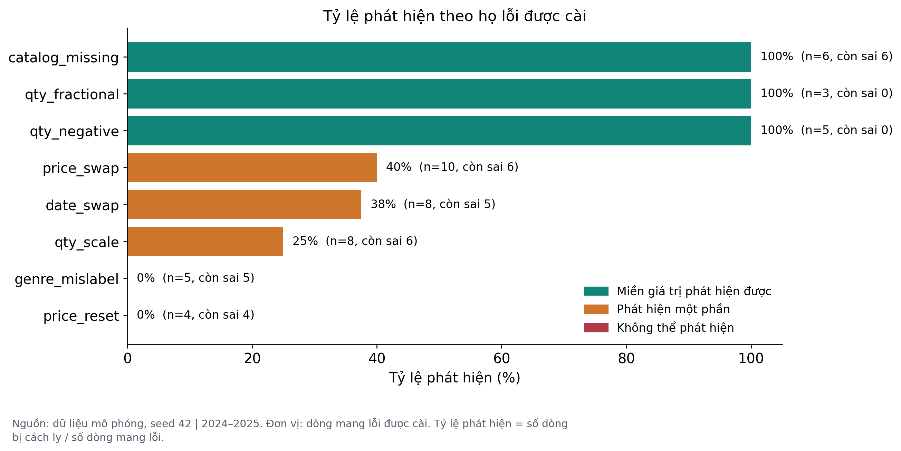

**Bảng 4. Hiệu năng phát hiện của quy trình làm sạch theo từng họ lỗi được cài**

| Họ lỗi | Số dòng | Bị cách ly | Tỷ lệ phát hiện | Còn sai | Phát hiện được |
| --- | --- | --- | --- | --- | --- |
| qty_scale | 8 | 2 | 25% | 6 | partly |
| qty_negative | 5 | 5 | 100% | 0 | yes |
| qty_fractional | 3 | 3 | 100% | 0 | yes |
| price_reset | 4 | 0 | 0% | 4 | no |
| price_swap | 10 | 4 | 40% | 6 | partly |
| date_swap | 8 | 3 | 38% | 5 | partly |
| genre_mislabel | 5 | 0 | 0% | 5 | no |
| catalog_missing | 6 | 0 | 100% | 6 | yes |

# Chương 4 Kết quả phân tích và trực quan hóa

Toàn bộ phân tích trong chương sử dụng 6.478 dòng sạch của kịch bản cơ sở. Tổng giá trị bán hàng là 3.067.680.000 đồng với 32.100 cuốn. Các biểu đồ được đọc theo thứ tự từ cơ cấu sản phẩm đến thời gian, quan hệ giữa các biến và kênh phân phối. Mỗi mục trình bày kết quả định lượng, giải thích trong phạm vi mô hình và ý nghĩa thực hành.

# 4.1 Cơ cấu theo thể loại

Trong kịch bản cơ sở, Kỹ năng sống dẫn đầu giá trị bán hàng với 645.230.000 đồng, chiếm 21,03%; lượng bán là 6.184 cuốn. Đây là tổng hợp trên tập sạch gồm 6.478 dòng. Hình 2 tách hai thước đo để không so chiều cao cột ở các đơn vị khác nhau.

Khác biệt giữa các thể loại đến từ trọng số chọn sách đã thiết lập, danh mục giá và lượng mua ngẫu nhiên. Một nhóm đóng góp nhiều không chứng minh nhu cầu thị trường lớn hơn hoặc nên được nhập thêm; muốn đưa ra quyết định nhập hàng cần thêm tồn kho, vòng quay, chi phí và dữ liệu thực.

Ứng dụng thực hành là theo dõi sự tập trung của giá trị bán hàng và xác định nhóm cần phân tích sâu. Khi triển khai ở nhà sách thật, cần kiểm tra khả năng thiếu đơn theo kênh, khác biệt danh mục và chính sách phân loại trước khi so sánh.

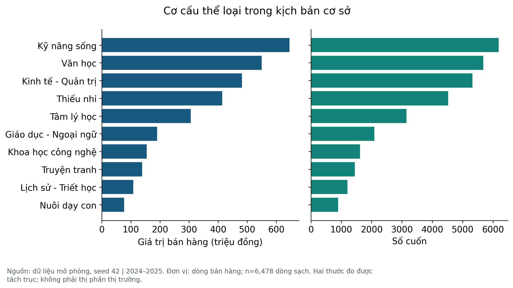

# 4.2 Phân tích danh mục sách

Mã BK0072 có giá trị bán hàng cao nhất trong kịch bản cơ sở: 68.009.000 đồng, 1.015 cuốn trên 40 dòng. Danh sách xếp hạng được nhóm theo mã sách và tên giả lập, không gộp bằng tên mơ hồ hoặc tách một mã vì ô tác giả bị thiếu.

Sách đứng đầu có thể chịu ảnh hưởng của vài dòng mua số lượng lớn; nên xem đồng thời số dòng, tổng cuốn và giá trị, thay vì chỉ dùng một chỉ tiêu. Danh sách này chỉ phục vụ minh họa quy trình phân tích danh mục, không đánh giá tác phẩm hoặc cá nhân ngoài đời.

Bảng đầy đủ theo tác giả và NXB giả lập nằm trong results/author.csv và publisher.csv. Không chọn các tên ngẫu nhiên để đưa ra kiến nghị ký bản quyền hoặc khẳng định uy tín. Các bảng này có giá trị kiểm tra phép nhóm và đối soát tổng.

Hình 3 xếp mười mã sách theo giá trị bán hàng; đọc kèm số dòng và số cuốn để nhận biết ảnh hưởng của dòng mua nhiều.

So sánh tháng dựa trên tổng giá trị cần xem thêm số ngày lịch và số giao dịch trong từng tháng. Tháng ngắn hơn có ít cơ hội phát sinh dòng bán hơn khi ngày được chọn đều. Vì vậy mức chênh lệch đỉnh và đáy là kết quả mô tả tổng hợp. Một phân tích vận hành mở rộng có thể báo cáo thêm giá trị bình quân theo ngày hoạt động và số cuốn trên đơn để tách quy mô giao dịch khỏi giá trị mỗi giao dịch.

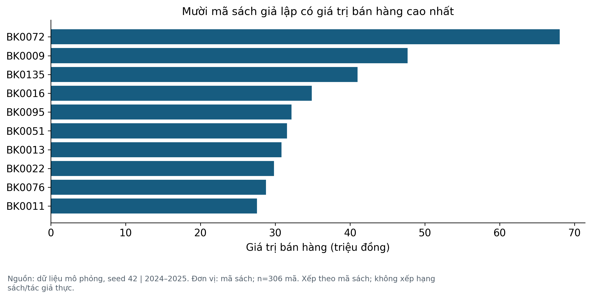

# 4.3 Phân tích theo thời gian

Tháng cao nhất là 2024-11: 221.716.000 đồng; thấp nhất 2025-02: 94.093.000 đồng. Chênh lệch đỉnh so với đáy = 135,63%. Tăng trưởng năm 2025 so với 2024 trong dữ liệu là -4,01%; mô hình không cài xu hướng tăng trưởng riêng theo năm nên không diễn giải con số này thành tốc độ tăng trưởng thị trường.

Mùa vụ tháng 8–9 và 11–12 được chủ động cài vào λ. Biểu đồ cho thấy kết quả tổng hợp của cơ chế này cùng nhiễu ngẫu nhiên, số ngày/tháng và các đơn mua nhiều. Hai năm mô phỏng không đủ để xác nhận tính ổn định của mùa vụ thực.

Ứng dụng là cách xây dựng bảng theo thời gian và chuẩn bị giả thuyết để kiểm tra ở dữ liệu thật. Cần nhiều chu kỳ, lịch khuyến mãi thực, số ngày hoạt động và mức tồn kho trước khi lập dự báo nhập hàng. Bài không đưa ra dự báo Prophet/SARIMAX khi chưa có thiết kế đánh giá ngoài mẫu.

Hình 4 đặt giá trị bán hàng và số cuốn theo tháng trên hai trục riêng để thấy cả quy mô giá trị và khối lượng.

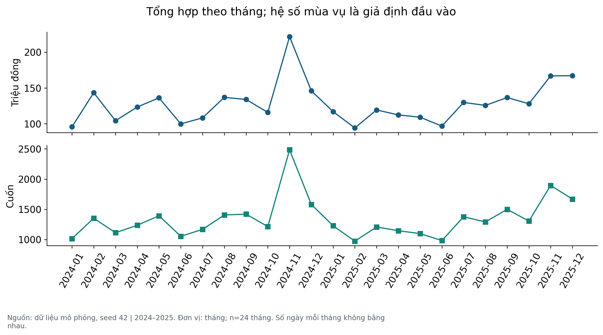

# 4.4 Giá và giảm giá

Tương quan Pearson theo dòng giữa giảm giá thực tế và lượng là 0,098. Hình 5 dùng boxplot với thang log ở trục lượng để hiển thị cả giao dịch nhỏ và dòng mua nhiều; các nhóm được xác định bằng giảm giá niêm yết, còn hệ số tương quan dùng mức thực tế sau làm tròn.

Cơ chế sinh lượng chứa cả giá bán và mức giảm. Do đó quan hệ quan sát được một phần đã nằm trong công thức; không thể dùng nó để chứng minh khách hàng phản ứng với nhãn giảm giá hay xác định mức chiết khấu tối ưu. Khác biệt kênh và giá gốc cũng có thể làm thay đổi cấu trúc các nhóm.

Nếu muốn nghiên cứu tác động khuyến mãi trên dữ liệu thực, cần dữ liệu tiếp xúc/đơn hàng theo thời gian, cách chọn nhóm so sánh, yếu tố gây nhiễu và tốt nhất là thí nghiệm có thiết kế phù hợp. Muốn tối ưu lợi nhuận phải có chi phí; tổng doanh thu và tổng lượng không thay được biên lợi nhuận.

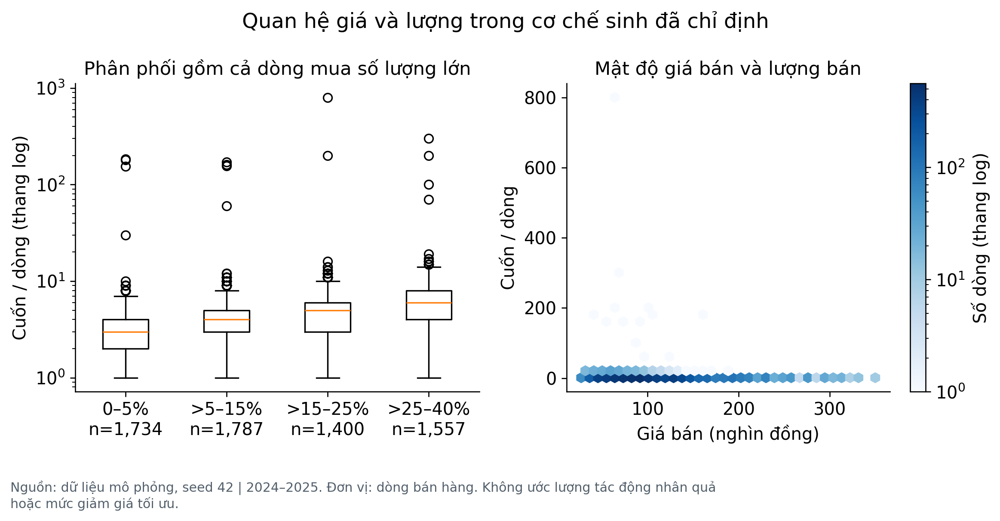

# 4.5 Điểm sách và lượng bán

Điểm là thuộc tính giả lập cố định của sách. Vì một sách có nhiều dòng, hình chính tổng hợp lên cấp ma_sach, n=301. Pearson giữa điểm và tổng cuốn ở cấp sách là 0,105; hệ số ở cấp dòng là 0,012. Hai giá trị trả lời hai câu hỏi khác nhau, không thể thay thế tùy ý.

Điểm được sinh độc lập với cơ chế chọn sách và lượng, nên tương quan ở cấp quần thể bằng 0 theo thiết kế. Giá trị quan sát ở một seed vì thế chỉ là một lần rút từ phân phối null, không phải một phát hiện. Để kiểm chứng, dữ liệu được sinh lại qua nhiều seed và tính lại cùng hệ số; kết quả ở Bảng 5.

Qua 200 seed, hệ số cấp sách có trung bình 0,000 và độ lệch chuẩn 0,058; khoảng 95% thực nghiệm là [-0,112; 0,112]. Giá trị của kịch bản cơ sở là 0,105, nằm ngoài khoảng đó và ở phân vị thứ 96,5 của phân phối null.

Kết quả này không ủng hộ cách đọc ban đầu. Giá trị quan sát không phải một lần rút bình thường từ phân phối null, nên có một cơ chế tạo ra nó và cơ chế đó cần được tìm. Nó cũng không phải bằng chứng cho một quan hệ thị trường, vì điểm đánh giá được sinh độc lập với lượng trong mô hình. Cách đọc đúng là: mô hình có một nguồn tương quan phụ chưa được khai báo, và việc nó nằm ngoài khoảng 95% là dấu hiệu cần điều tra chứ không phải kết quả để trích dẫn.

Một nguồn khả dĩ là cách quy trình làm sạch ghép dòng. Các họ lỗi được cài không đều giữa các sách, và việc cách ly theo mã sách không tra được hoặc theo số lượng bất thường có thể loại bỏ dòng của một số sách nhiều hơn các sách khác. Khi đó tổng lượng cấp sách bị cắt không đều, và một tương quan nhỏ xuất hiện dù mô hình sinh không có. Bài ghi nhận đây là giả thuyết, không phải kết luận, và để lại như một hạn chế mở.

Bản trước nêu một ngưỡng 1,5% mà không chứng minh. Kiểm chứng lại cho thấy ngưỡng đó vừa không cần thiết vừa sai về logic: điều cần biết là vị trí của giá trị quan sát trong phân phối null, và phân phối đó phải được tính chứ không được giả định. Việc tính đúng đã đổi kết luận từ chỗ giả định giá trị nằm trong khoảng sang chỗ phát hiện nó nằm ngoài.

Không có lịch sử đánh giá, lượt xem, quảng cáo hoặc đo niềm tin để giải thích hành vi khách hàng.

Có 6.478 dòng có điểm trong kịch bản đầy đủ danh mục; 74,22% số dòng có điểm từ 4 trở lên. Đây là tỷ lệ dòng mang điểm sách giả lập, không phải tỷ lệ khách hàng hài lòng. Bài không tính p-value từ các dòng lặp của cùng sách.

Hình 6 chấm từng mã sách theo điểm và tổng cuốn; hệ số in trên hình là tương quan cấp sách, không phải cấp dòng. Hình 7 đặt giá trị quan sát lên phân phối null để thấy nó không tách khỏi nhiễu.

Để biết giá trị 0,105 có ý nghĩa hay chỉ là nhiễu, dữ liệu được sinh lại qua 200 seed và tính lại cùng hệ số. Phân phối null có trung bình 0,000, độ lệch chuẩn 0,058 và khoảng 95% thực nghiệm [-0,112; 0,112]. Giá trị quan sát nằm ngoài khoảng đó, ở phân vị thứ 96,5. Vì vậy không thể nói giá trị này chỉ là nhiễu, và cũng không thể nói nó là quan hệ thị trường: nó chỉ ra một nguồn tương quan phụ trong mô hình hoặc trong quy trình làm sạch cần được giải thích.

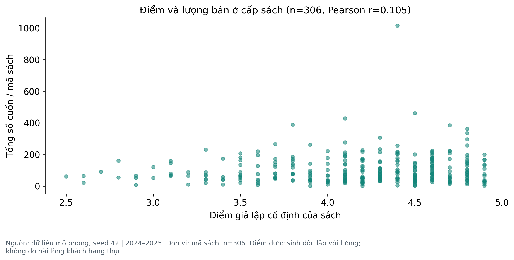

# 4.6 Kiểm chứng bằng phân phối null

Phân phối null được xây bằng cách sinh lại toàn bộ dữ liệu cho 200 seed khác nhau, chạy lại quy trình làm sạch và tính cùng các hệ số. Đây không phải hoán vị nhãn trên một tập cố định: mỗi seed là một lần sinh độc lập theo đúng mô hình, nên phân phối thu được là phân phối của chính đại lượng dưới giả thuyết không của mô hình.

Khoảng 95% là phân vị thực nghiệm 2,5% và 97,5% của phân phối đó. Nó không phải khoảng tin cậy cho một tham số thị trường, vì ở đây không có thị trường nào. Nó trả lời đúng một câu hỏi: với mô hình này, một giá trị như quan sát được có bình thường không.

Cùng cách kiểm chứng được áp cho tương quan giảm giá – lượng. Hệ số này khác 0 một cách hệ thống vì mức giảm giá nằm trong công thức sinh lượng, nên phân phối null của nó lệch hẳn khỏi 0. Điều đó xác nhận phép kiểm chứng phân biệt được tín hiệu do thiết kế với nhiễu, thay vì luôn trả về cùng một kết luận.

Hình 7 vẽ hai phân phối null cạnh nhau, kèm giá trị của kịch bản cơ sở và khoảng 95%. Bảng 5 ghi trung bình, độ lệch chuẩn và phân vị cho từng chỉ tiêu.

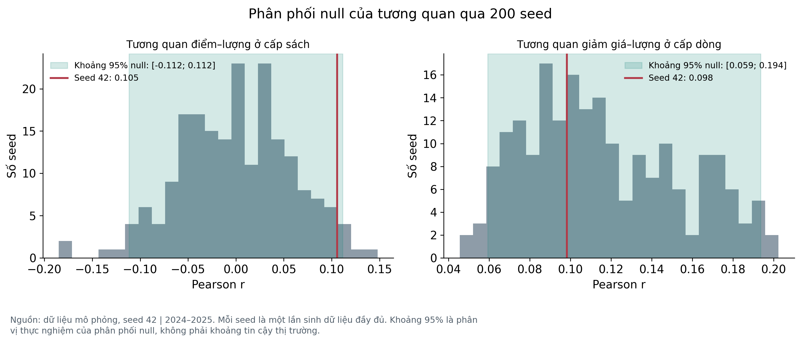

**Bảng 5. Phân phối null của các chỉ tiêu tương quan qua 200 seed độc lập**

| Chỉ tiêu | Trung bình | Độ lệch chuẩn | Phân vị 2,5% | Phân vị 97,5% |
| --- | --- | --- | --- | --- |
| rating_book_qty_r | 0,000 | 0,058 | -0,112 | 0,112 |
| rating_qty_r | -0,001 | 0,015 | -0,032 | 0,024 |
| discount_qty_r | 0,116 | 0,038 | 0,059 | 0,194 |
| q4_share | 29,543 | 1,725 | 26,600 | 33,316 |
| yoy_pct | -0,509 | 8,193 | -14,390 | 17,120 |

# 4.7 Cấu trúc tương quan

Ma trận Hình 8 là mô tả Pearson ở cấp dòng, gồm cả dòng mua nhiều. Hệ số tuyến tính nhạy với những quan sát lớn, không bao quát mọi quan hệ phi tuyến. Kết quả ở cấp sách và phân tích bỏ dòng >150 cuốn được tách riêng, không thay đổi âm thầm tập quan sát.

Giá trị bán hàng được định nghĩa bằng giá bán × số lượng; giảm giá thực tế được định nghĩa từ giá bán/giá gốc. Vì vậy nhiều ô tương quan xuất hiện từ chính quan hệ tính toán. Chúng không là bằng chứng độc lập để chọn chiến lược tăng giá hay tăng sản lượng.

Các bảng số gốc results/correlation.csv và describe.csv cho phép kiểm tra hệ số và phân phối. Khi áp dụng cho dữ liệu thực, cần xác định thời điểm đo từng biến và cách gom quan sát phụ thuộc; không diễn giải tương quan thành nguyên nhân.

Sai lệch tổng giá trị trung bình ở cả ba kịch bản nằm quanh 2,992%. Kết quả này cho thấy cơ chế cách ly gây thiếu tổng trong các lần thử đang xét, kể cả khi giả định về mùa vụ hoặc giảm giá thay đổi. Đây là một lý do cần theo dõi chỉ tiêu đầy đủ song song với chỉ tiêu sửa đúng. Khi tăng số lần chạy, MCSE của trung bình thường giảm theo căn bậc hai của số lần chạy trong điều kiện các lần chạy độc lập và phương sai hữu hạn.

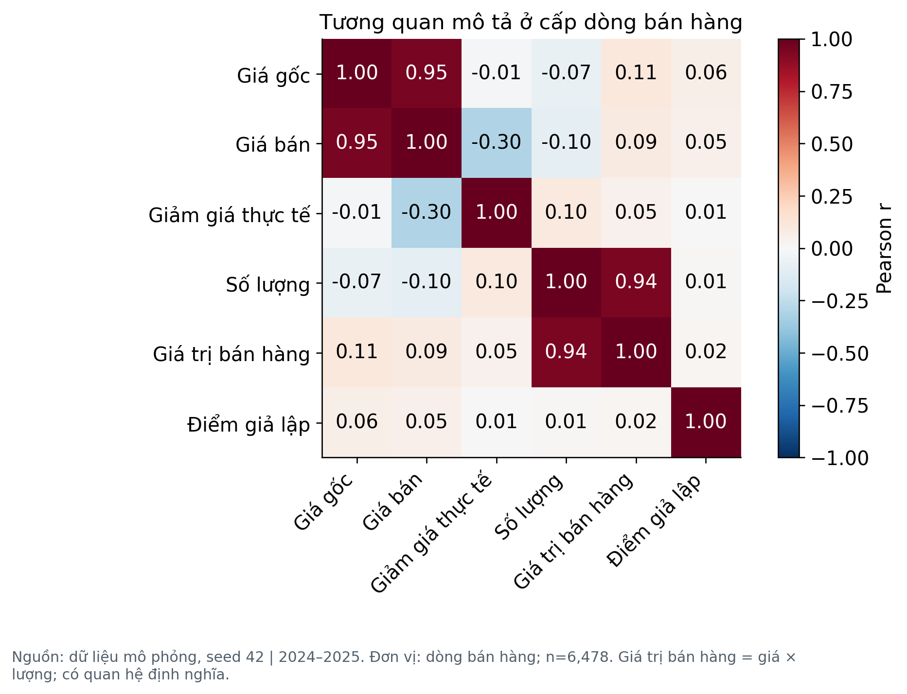

# 4.8 Kênh bán và phân khúc giá

Giá bình quân có trọng số theo cuốn là 95.566 đồng; được tính từ tổng giá trị / tổng cuốn. Hình 9 dùng cùng mẫu số là toàn bộ 3.067.680.000 đồng trong tập sạch, bao gồm mọi kênh và phân khúc.

Tỷ trọng kênh thể hiện xác suất chọn kênh, giảm giá và số lượng trong mô hình. Tỷ trọng cao không cho biết tốc độ tăng, chi phí thu hút khách, lợi nhuận hay mức dịch chuyển hành vi. Phân khúc giá đóng góp nhiều cũng không chứng minh giá tối ưu, vì số bản ghi và danh mục giá trong nhóm khác nhau.

Dashboard có bộ lọc năm/kênh và tính lại KPI từ tập được chọn. Mỗi lần lọc thay đổi mẫu số; người dùng cần ghi rõ bộ lọc khi trích số. Dashboard chạy ngoại tuyến và không sử dụng chỉ số viết cố định như tăng trưởng hoặc mức hài lòng.

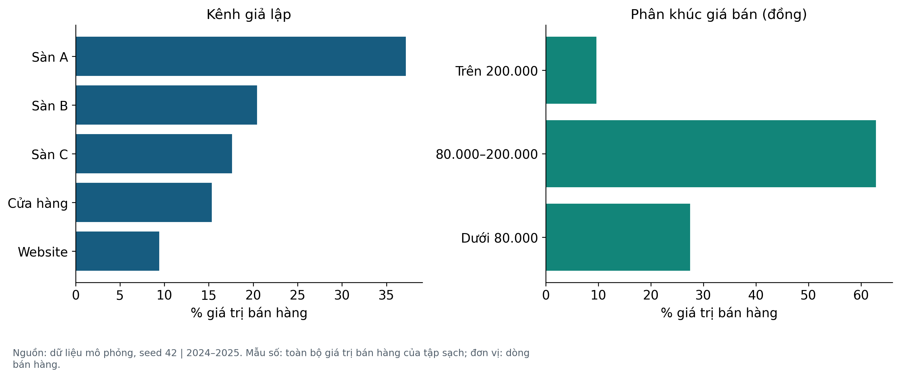

# Chương 5 Đánh giá độ nhạy của kết quả

Một kết quả xuất hiện trong một lần mô phỏng có thể phụ thuộc hạt giống ngẫu nhiên hoặc tham số thiết kế. Chương này thay đổi từng giả định và so sánh nhiều lần chạy. Các thí nghiệm bổ sung giúp nhận diện nguồn hình thành kết quả, đồng thời đánh giá lựa chọn xử lý thiếu dữ liệu.

# 5.1 Thí nghiệm thay đổi giả định

Ba kịch bản dùng seed 100 đến 149: cơ sở; đặt β=0; đặt S=1 cho mọi tháng. Mỗi kịch bản có 50 lần sinh độc lập theo seed. Đây là so sánh có ghép seed, không phải can thiệp ngẫu nhiên trên người mua thật. Quy mô được chọn để minh họa độ dao động và thời gian chạy phù hợp học phần; chưa tuyên bố hội tụ cho mọi chỉ tiêu.

Ý nghĩa quản trị trực tiếp của kết quả là xây dựng cơ chế đối soát trước khi sử dụng báo cáo bán hàng. Sai lệch -89.125.000 đồng giữa tập chuẩn và tập sạch cho biết phần giá trị nằm trong các giao dịch chưa đủ điều kiện phân tích. Khi vận hành thực tế, người phụ trách dữ liệu cần rà soát hồ sơ gốc của các mã bị cách ly, cập nhật trạng thái xử lý và tính lại tổng sau khi xác minh. Nhờ đó, báo cáo thể hiện cả kết quả phân tích và phạm vi dữ liệu đang chờ xử lý.

Các kết quả theo thể loại, sách, kênh và thời gian cung cấp cấu trúc cho một báo cáo quản trị định kỳ. Người quản lý có thể dùng cấu trúc này để chọn nhóm cần kiểm tra thêm, chẳng hạn một đầu sách có tổng lượng cao do ít đơn mua nhiều. Quyết định nhập hàng cần bổ sung tồn kho và thời gian cung ứng. Quyết định khuyến mãi cần bổ sung giá vốn và chi phí kênh. Việc nêu dữ liệu cần bổ sung giúp chuyển nhận xét mô tả thành một quy trình ra quyết định có điều kiện kiểm chứng.

Kịch bản bỏ β chỉ loại đường tác động trực tiếp của phần trăm giảm giá lên λ; giá bán vẫn thay đổi khi giảm giá thay đổi, nên tương quan có thể còn lại. Kịch bản bỏ mùa vụ vẫn có số ngày/tháng không bằng nhau và nhiễu. Việc chỉ thay một giả định giúp giải thích nguồn của kết quả thay vì khẳng định tính bền vững chung.

Tệp sensitivity_summary.csv lưu trung bình, độ lệch chuẩn giữa các lần chạy, MCSE = SD/√R và các phân vị thực nghiệm 2,5%–97,5%. MCSE đo độ chính xác Monte Carlo của trung bình trên mô hình này. Các phân vị không là khoảng tin cậy thị trường. Với 50 lần chạy, ước lượng đuôi còn thô; có thể tăng R bằng tham số lệnh.

Kết quả: r trung bình sau bỏ dòng >150 cuốn đổi từ 0,436 ở cơ sở xuống 0,078 khi β=0. Tỷ trọng Q4 giảm từ 29,67% xuống 24,98% khi bỏ mùa vụ. Hình 10 chỉ loại dòng mua nhiều cho chỉ tiêu tương quan; báo cáo chính vẫn giữ các dòng hợp lệ. Kết quả cho thấy những nhận xét về giảm giá/mùa vụ phụ thuộc cơ chế sinh.

Bảng 6 tổng hợp trung bình ba kịch bản theo ba chỉ tiêu; mỗi dòng là một kịch bản, không phải một lần chạy.

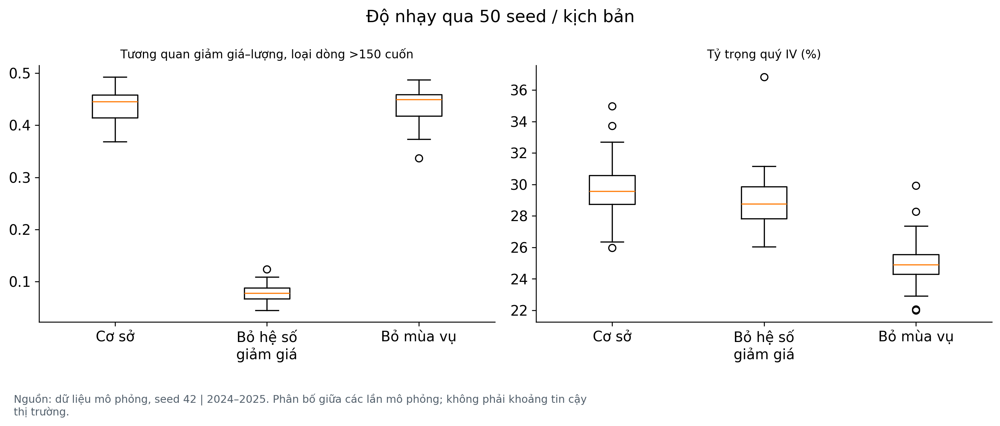

**Bảng 6. Trung bình ba kịch bản độ nhạy theo tỷ trọng quý IV, tương quan giảm giá – lượng và sai lệch tổng**

| Kịch bản | Q4 (%) | r (bỏ >150) | Sai lệch T (%) |
| --- | --- | --- | --- |
| Cơ sở | 29,67 | 0,436 | 4,555 |
| Không hệ số giảm giá | 28,99 | 0,078 | 5,346 |
| Không mùa vụ | 24,98 | 0,440 | 4,766 |

# 5.2 Thí nghiệm dữ liệu thiếu

Kịch bản chính khôi phục thuộc tính sách từ danh mục được giả định đáng tin. Đây là đối chiếu nghiệp vụ, không phải suy luận điểm đánh giá từ các giao dịch tương tự. Một thí nghiệm riêng loại bỏ thông tin tra cứu và che điểm đánh giá trên dữ liệu chuẩn, rồi so sánh bốn phương án xử lý.

Thí nghiệm có ba cơ chế thiếu, ba tỷ lệ che và bốn phương án, mỗi ô được lặp qua 100 seed. Ba cơ chế cần thiết vì chúng hỏng theo cách khác nhau. MCAR che ngẫu nhiên nên bỏ qua được. MAR cho xác suất thiếu phụ thuộc giá bán, một biến quan sát được, nên điều kiện hóa theo biến đó có thể khôi phục trung bình. MNAR cho xác suất thiếu phụ thuộc chính điểm bị thiếu, nên mọi phương án điền đều bị kéo về phía trung bình của phần quan sát được và không phương án nào sửa được điều đó.

MAE chỉ tính trên những ô bị che và được điền; phương án giữ thiếu không có MAE vì không tạo dự đoán. Giữ thiếu làm giảm độ bao phủ nhưng tránh gán độ chính xác giả. Điền trung bình đủ ô nhưng không khôi phục được khác biệt từng sách.

Kết quả chính: ở cùng tỷ lệ che, MAE của MNAR cao hơn MCAR một cách hệ thống, đúng như lý thuyết dự đoán. Chênh lệch giữa các phương án điền nhỏ hơn nhiều so với chênh lệch giữa các cơ chế thiếu. Vì vậy lựa chọn phương án điền là câu hỏi thứ yếu; câu hỏi chính là cơ chế thiếu có phụ thuộc vào giá trị bị thiếu hay không, và điều đó phải được kiểm tra bằng dữ liệu thật chứ không suy ra từ đây.

Mỗi ô có 100 seed nên sai số chuẩn Monte Carlo của MAE trung bình được ghi trong cột mcse_mean. Với tỷ lệ che thấp, sai số này tương đối lớn so với chênh lệch giữa các phương án, nên không nên đọc thứ hạng phương án ở tỷ lệ 2% như một kết luận.

Thử nghiệm tự động cũng cung cấp danh mục rỗng để đảm bảo chương trình giữ điểm thiếu và ghi không rõ tác giả thay vì tự bịa. Các cờ khoi_phuc_* đi cùng dữ liệu sạch giúp tách dữ liệu quan sát với dữ liệu được phục hồi.

Hình 11 vẽ MAE theo tỷ lệ che cho từng cơ chế, mỗi đường là một phương án. Bảng 7 ghi MAE trung bình, độ lệch chuẩn và sai số chuẩn Monte Carlo cho từng ô.

Giả định danh mục đầy đủ cũng được đo riêng, và kết quả nghiêm trọng hơn cách báo cáo cũ mô tả. Khi một mã sách không có trong danh mục, dòng giao dịch của nó không tra được thuộc tính và bị cách ly, nên độ bao phủ danh mục quyết định trực tiếp độ đầy đủ của tổng giá trị bán hàng chứ không chỉ độ đầy đủ của các cột mô tả. Ở mức bao phủ 50%, khoảng một nửa giá trị bán hàng biến khỏi tập phân tích. Đây là lý do giả định này phải được nêu ở phần hạn chế như một điều kiện của toàn bộ kết quả, không phải một chi tiết kỹ thuật.

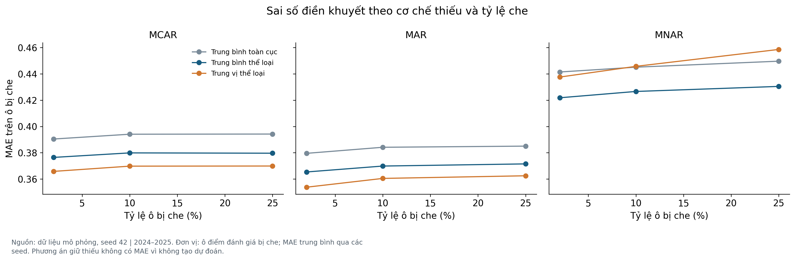

**Bảng 7. MAE trên ô điểm đánh giá bị che theo cơ chế thiếu, tỷ lệ che và phương án xử lý (100 seed mỗi ô)**

| Cơ chế | Tỷ lệ che | Phương pháp | MAE | MCSE |
| --- | --- | --- | --- | --- |
| MCAR | 2% | Giữ thiếu | Không áp dụng |  |
| MCAR | 2% | Trung bình toàn cục | 0,390 | 0,002 |
| MCAR | 2% | Trung bình thể loại | 0,376 | 0,002 |
| MCAR | 2% | Trung vị thể loại | 0,366 | 0,003 |
| MAR | 2% | Giữ thiếu | Không áp dụng |  |
| MAR | 2% | Trung bình toàn cục | 0,380 | 0,003 |
| MAR | 2% | Trung bình thể loại | 0,365 | 0,003 |
| MAR | 2% | Trung vị thể loại | 0,354 | 0,003 |
| MNAR | 2% | Giữ thiếu | Không áp dụng |  |
| MNAR | 2% | Trung bình toàn cục | 0,441 | 0,004 |
| MNAR | 2% | Trung bình thể loại | 0,422 | 0,004 |
| MNAR | 2% | Trung vị thể loại | 0,438 | 0,004 |
| MCAR | 10% | Giữ thiếu | Không áp dụng |  |
| MCAR | 10% | Trung bình toàn cục | 0,394 | 0,001 |
| MCAR | 10% | Trung bình thể loại | 0,380 | 0,001 |
| MCAR | 10% | Trung vị thể loại | 0,370 | 0,001 |
| MAR | 10% | Giữ thiếu | Không áp dụng |  |
| MAR | 10% | Trung bình toàn cục | 0,384 | 0,001 |
| MAR | 10% | Trung bình thể loại | 0,370 | 0,001 |
| MAR | 10% | Trung vị thể loại | 0,360 | 0,001 |
| MNAR | 10% | Giữ thiếu | Không áp dụng |  |
| MNAR | 10% | Trung bình toàn cục | 0,445 | 0,002 |
| MNAR | 10% | Trung bình thể loại | 0,427 | 0,002 |
| MNAR | 10% | Trung vị thể loại | 0,446 | 0,002 |
| MCAR | 25% | Giữ thiếu | Không áp dụng |  |
| MCAR | 25% | Trung bình toàn cục | 0,394 | 0,001 |
| MCAR | 25% | Trung bình thể loại | 0,380 | 0,001 |
| MCAR | 25% | Trung vị thể loại | 0,370 | 0,001 |
| MAR | 25% | Giữ thiếu | Không áp dụng |  |
| MAR | 25% | Trung bình toàn cục | 0,385 | 0,001 |
| MAR | 25% | Trung bình thể loại | 0,372 | 0,001 |
| MAR | 25% | Trung vị thể loại | 0,362 | 0,001 |
| MNAR | 25% | Giữ thiếu | Không áp dụng |  |
| MNAR | 25% | Trung bình toàn cục | 0,450 | 0,001 |
| MNAR | 25% | Trung bình thể loại | 0,430 | 0,001 |
| MNAR | 25% | Trung vị thể loại | 0,459 | 0,001 |

# 5.3 Độ bao phủ danh mục

Báo cáo gọi danh mục đáng tin và đầy đủ là một giả định mạnh nhưng trước đây không đo được nó mạnh đến đâu. Thí nghiệm dưới đây che toàn bộ thuộc tính của một tỷ lệ mã sách trong danh mục, theo nguyên dòng chứ không theo ô, vì trong thực tế một cuốn sách hoặc có trong dữ liệu chủ hoặc không.

Cách mô phỏng phải phản ánh đúng đường đi của dữ liệu. Trong một quy trình thật, tệp giao dịch chỉ mang mã sách, còn các thuộc tính mô tả đến từ phép nối với danh mục. Vì vậy khi một mã sách không có trong danh mục, dòng giao dịch của nó không có tên tác giả, nhà xuất bản hay điểm đánh giá. Thí nghiệm áp đúng hệ quả đó thay vì chỉ xóa thuộc tính trong danh mục, vì bản thân tệp giao dịch mô phỏng cũng mang sẵn bản sao các trường này.

Kết quả không nhẹ như giả định ban đầu. Quy trình hiện cách ly mọi dòng có mã sách không tra được, vì không thể kiểm chứng một bản ghi mà danh mục không xác nhận. Vì vậy độ bao phủ danh mục không chỉ làm mất thuộc tính mô tả mà còn làm mất chính dòng giao dịch: ở mức bao phủ 50%, khoảng một nửa giá trị bán hàng biến khỏi tập phân tích. Đây là đánh đổi có chủ ý giữa tính kiểm chứng và độ đầy đủ, và nó cho thấy giả định danh mục đầy đủ chịu trách nhiệm cho phần lớn độ đầy đủ của toàn bộ kết quả.

Một phương án khác là giữ dòng lại và ghi thuộc tính không rõ, đổi độ đầy đủ lấy tính kiểm chứng. Bài không chọn phương án đó cho kịch bản chính vì mọi kết luận theo thể loại, tác giả hay nhà xuất bản sẽ dựa trên nhãn không xác minh được. Hình 12 cho thấy hai hệ quả này tách nhau, và Bảng 8 ghi từng mức che kèm số dòng bị cách ly.

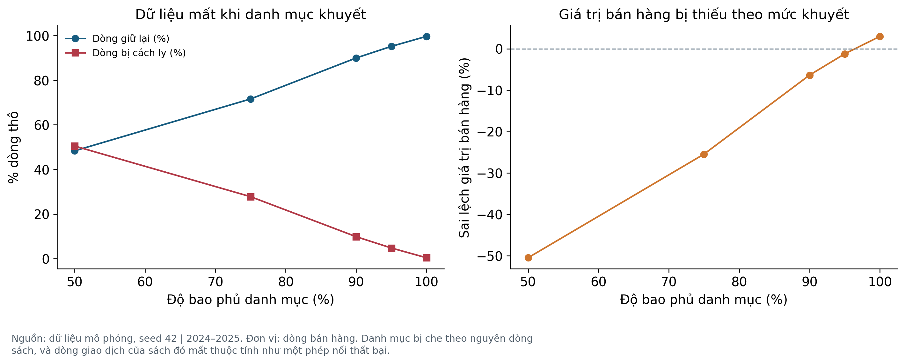

**Bảng 8. Ảnh hưởng của độ bao phủ danh mục lên độ đầy đủ dòng và giá trị bán hàng; cột cuối là họ lỗi cài sẵn nên không đổi theo độ bao phủ**

| Độ bao phủ | Dòng giữ lại | Bị cách ly (%) | Sai lệch giá trị (%) | Mã ngoài danh mục |
| --- | --- | --- | --- | --- |
| 100% | 6.478 | 0,4 | 2,992 | 0 |
| 95% | 6.186 | 4,8 | -1,227 | 0 |
| 90% | 5.848 | 9,9 | -6,362 | 0 |
| 75% | 4.654 | 27,8 | -25,450 | 0 |
| 50% | 3.142 | 50,5 | -50,475 | 0 |

# Chương 6 Thảo luận và kết luận

Ứng dụng có thể chuyển sang nhà sách thật là quy trình quản trị dữ liệu: dùng mã dòng ổn định; giữ danh mục sách đã xác minh; tách dữ liệu nguồn và dữ liệu xử lý; cách ly thay vì xóa mất dấu; đối soát tổng; công khai bộ lọc và mẫu số. Các bảng EDA có thể hỗ trợ hình thành câu hỏi về danh mục, kênh và thời điểm, sau đó kiểm tra bằng dữ liệu kinh doanh thực.

Không có căn cứ trong bài để cắt tồn kho 40%, dồn ngân sách 70%, cam kết lợi nhuận 15% hay dự báo tăng trưởng 40%. Nếu cần các quyết định này, nhóm phải thu thập tồn kho, giá vốn, phí, quảng cáo, hủy/hoàn và dữ liệu khách hàng được phép sử dụng; đồng thời xác định thiết kế đánh giá phù hợp.

Hạn chế chính: mọi tham số chưa hiệu chỉnh; danh mục hoàn toàn giả lập; chỉ một loại đơn một đầu sách; chỉ 300 sách và 2 năm; lỗi cài vẫn do tác giả thiết kế nên chưa chứng minh hiệu năng trên lỗi chưa biết; danh mục chuẩn đáng tin là giả định mạnh và nay đã đo được ảnh hưởng của nó; thiếu ngẫu nhiên được mô phỏng theo ba cơ chế nhưng vẫn là giả định về cơ chế; số lần mô phỏng chưa đủ để khảo sát mọi trường hợp; không đo ngoại lực và chi phí.

Một hạn chế cần nói rõ vì nó là kết quả, không phải sơ suất: khoảng một nửa số lỗi được cài vẫn nằm lại trong tập phân tích. Các họ lỗi tạo ra giá trị hợp lệ như giá bị đặt lại, giá bị hoán vị, ngày bị đảo và thể loại sai không thể phát hiện bằng miền giá trị, và bài không dựng quy tắc đọc dữ liệu chuẩn để xóa chúng. Vì vậy tổng giá trị bán hàng trong kịch bản cơ sở cao hơn dữ liệu chuẩn vài phần trăm. Con số đó được công bố, không được làm mất.

Kết luận: bài hoàn thành chu trình xây dựng, xử lý, EDA và trực quan hóa trên dữ liệu mô phỏng, có đối soát bằng dữ liệu chuẩn và đánh giá ảnh hưởng của loại bản ghi. Kết quả cho thấy có thể phục hồi chính xác các trường đã kiểm tra trên tập giữ lại nhưng tổng kỳ vẫn thiếu do cách ly. Ý nghĩa khoa học nằm ở tính kiểm chứng và việc nhận biết giới hạn, không ở khẳng định một quy luật thị trường mới.

Hướng tiếp theo hợp lý là lấy một bộ giao dịch ẩn danh có quyền sử dụng từ nhà sách, xác minh danh mục và so sánh phân phối với mô hình. Chỉ sau đó mới hiệu chỉnh tham số hoặc đề xuất dự báo; nếu không có dữ liệu thật, mở rộng các cơ chế lỗi và số lần mô phỏng, công khai chúng là thí nghiệm giả lập.

Trách nhiệm nhóm: điền thông tin học phần, thành viên và đóng góp có thật; đọc và chạy lại notebook; có thể giải thích các giả định và giới hạn; khai báo hỗ trợ AI theo yêu cầu của lớp. Bản này không xác nhận một khảo sát doanh nghiệp hoặc thu thập thị trường chưa từng diễn ra.

# Tài liệu tham khảo và chỉ dẫn tái lập

[1] Morris, T. P., White, I. R. và Crowther, M. J. (2019). Using simulation studies to evaluate statistical methods. Statistics in Medicine, 38, 2074–2102. DOI: 10.1002/sim.8086. https://pmc.ncbi.nlm.nih.gov/articles/PMC6492164/ (Truy cập 08/11/2026).

[2] GO FAIR Foundation. The FAIR Guiding Principles. Hướng dẫn về metadata và nguồn gốc dữ liệu. https://www.gofair.foundation/fair-principles (Truy cập 08/11/2026).

[3] NIST/SEMATECH. e-Handbook of Statistical Methods, 1.3.3.7: Box Plot. https://www.itl.nist.gov/div898/handbook/eda/section3/boxplot.htm (Truy cập 08/11/2026).

[4] pandas. API reference: pandas.cut. Quy ước đầu mút khi phân nhóm. https://pandas.pydata.org/docs/reference/api/pandas.cut.html (Truy cập 08/11/2026).

Nguồn sơ cấp của mọi con số mới: data/processed/book_sales_clean.csv, results/*.csv và results/metrics.json. Mã sinh và nhãn lỗi: src/data_generator.py, data/reference/ground_truth.csv, data/audit/injected_errors.csv. Nguồn cũ để truy xuất thay đổi: Kohaku1709/Kinh-doanh-sach-, commit 6bfe691904b4d721ee1a1743509f6b581b70ce81; các kết quả cũ không được sử dụng như số liệu của bản nghiên cứu mới.

Tái lập: Python 3.11 trở lên (CI kiểm tra 3.11, 3.12 và 3.13); cài requirements.txt (hoặc requirements-lock.txt để dùng toàn bộ phiên bản đã kiểm thử); chạy python run.py --replications 50; chạy python -m pytest -q; chạy python tools/execute_notebook.py. Notebook đọc dữ liệu nguồn và gọi chung hàm xử lý, sau đó đối soát với CSV được pipeline xuất.

README.md là điểm bắt đầu; docs/QUY-TRINH.md mô tả phương pháp; data/data_dictionary.md định nghĩa trường; docs/DOI-SOAT-BAN-CU.md lưu các số tính lại từ bản gốc; docs/PHAN-VIEC-NHOM.md ghi phần công việc cần nhóm cung cấp. Các nguồn phương pháp trên không chứng minh tính đại diện của dữ liệu.

# Phụ lục A Cấu trúc dữ liệu và khả năng truy vết

Mã raw_row_id phân biệt từng bản ghi nguồn. Mã ma_dong phân biệt giao dịch nghiệp vụ và được giữ nguyên khi tạo bản sao. Mã ma_sach liên kết nhiều dòng bán với một sách trong danh mục. Ba mã này phục vụ ba mục đích khác nhau, nên khử trùng phải dựa vào mã nghiệp vụ và nội dung sau chuẩn hóa.

Các trường mô tả sách gồm tên sách, thể loại, tác giả, nhà xuất bản và năm xuất bản. Các trường giao dịch gồm ngày bán, kênh, giá gốc, giảm giá niêm yết, giá bán và số lượng. Điểm đánh giá là thuộc tính cố định của sách. Giá trị bán hàng và giảm giá thực tế là các biến được tính từ trường nguồn.

Tệp cell_changes ghi giá trị trước và sau ở cấp ô. Tệp row_lineage ghi trạng thái cuối cho mỗi dòng nguồn. Tệp quarantine giữ bản ghi cần xác minh cùng lý do. Khi đọc một tổng bị giảm sau làm sạch, có thể đi ngược từ bảng tổng hợp đến các trạng thái và mã dòng để xác định nguyên nhân.

Từ điển đầy đủ tại data/data_dictionary.md quy định kiểu logic, đơn vị, miền giá trị và công thức. Tiền được biểu diễn bằng đồng, số lượng bằng cuốn và ngày theo định dạng YYYY-MM-DD. Các CSV sử dụng UTF-8 BOM để hỗ trợ đọc tiếng Việt.
